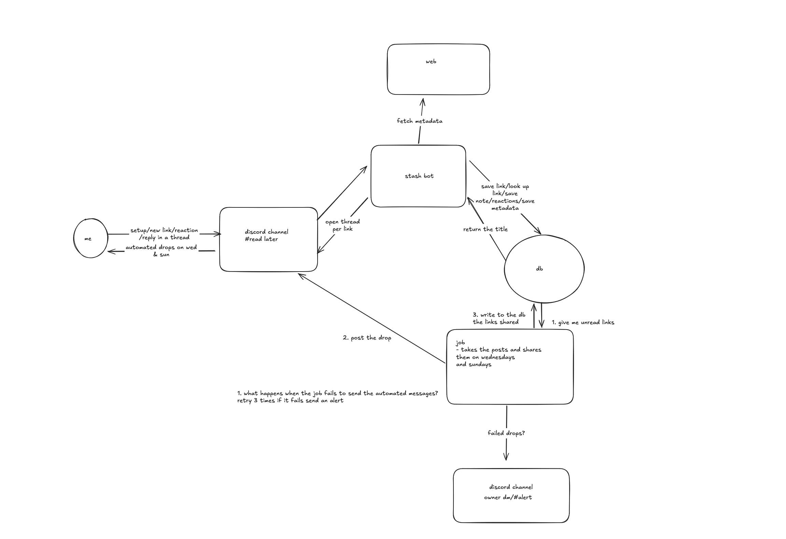

# stash

a discord bot that saves links from a `#read-later` channel and drops a couple of picks on a schedule.

## how it works



one python service (discord.py + asyncpg) and one postgres database, both on railway. everything in the database is scoped by server, so each server only sees its own links.

**saving a link**
1. you post a link in `#read-later`. the bot normalizes the url (drops tracking params, `www.`, trailing slashes) and saves it, or reacts 🔁 if it's already in your queue. saving never waits on anything below.
2. in the background it fetches the page for its title, description and reading time. only public addresses are fetched, with a timeout and a size cap.
3. it opens a thread on your post, named after the page. anything you write there is saved as a note on the link.
4. if the server has brought its own ai key (`/setkey`), the link gets 1–3 interest tags from that provider (claude, openai, gemini, deepseek or openrouter).

**drops**
1. a scheduler ticks once a minute. on each server's drop days (default wednesday + sunday, 09:00 utc) it claims the slot in the database, so a restart or a second instance never sends the same drop twice.
2. it picks 2 unread links per person, weighted at random towards older, shorter, less-sent links and ones that share tags with links you've loved.
3. it posts them in `#read-later` and records what was sent.
4. if posting fails it retries 3 times, 5 minutes apart. then it alerts the server owner (dm, or the channel set with `/setup`) and the host (`ALERT_WEBHOOK_URL`).

**reacting**
- ✅ marks a link read, so drops stop sending it. 👍 (any skin tone) marks it loved. removing the reaction undoes it.

**commands**

| command | what it does |
|---|---|
| `/picks` | 2 picks from your unread links now |
| `/random` | one random unread link |
| `/schedule` | see or change drop days, hour and timezone |
| `/setup` | see or change where failed-drop alerts go |
| `/setkey` | bring your own ai key for tagging (keys are stored encrypted) |
| `/ping` | check the bot and database are up |

more detail and the reasoning behind these choices: [`docs/system-design.md`](docs/system-design.md).

## run locally

needs python 3.13 and postgres.

```sh
python -m venv .venv && source .venv/bin/activate
pip install -r requirements.txt
cp .env.example .env   # fill in DISCORD_TOKEN
createdb stash
set -a && source .env && set +a
python -m stash
```

migrations in `migrations/` apply automatically on startup.

in the discord developer portal, enable the **message content** intent for the bot, and invite it with the `bot` and `applications.commands` scopes. set `DEV_GUILD_ID` to your test server so slash commands show up instantly.

make a channel named `#read-later` and give the bot **view channel**, **send messages**, **add reactions**, **read message history**, **create public threads** and **send messages in threads** there. any link posted in it is saved: 🔖 means saved, 🔁 means it's already in your queue. each saved post gets a thread named after the page; anything you write in it is kept as a note on the link.

## tests

```sh
pip install -r requirements-dev.txt
createdb stash_test   # the database tests use; they're skipped if it's missing
pytest
```

## deploy to railway

1. create a project from this repo and add a postgres service.
2. on the bot service, set:
   - `DISCORD_TOKEN`
   - `DATABASE_URL=${{Postgres.DATABASE_URL}}`
   - `STASH_SECRET_KEY`: encrypts the ai keys servers bring with `/setkey`. generate one with `openssl rand -base64 32 | tr '+/' '-_'` and keep a copy; losing it means every server re-enters its key.
   - `ALERT_WEBHOOK_URL` (optional): a discord webhook where the host hears about failed drops in any server.
   - don't set `DEV_GUILD_ID` in production, so slash commands register everywhere.
3. deploy. `railway.json` sets the start command (`python -m stash`). pushes to `main` deploy automatically.

full self-hosting docs come with issue #13.
