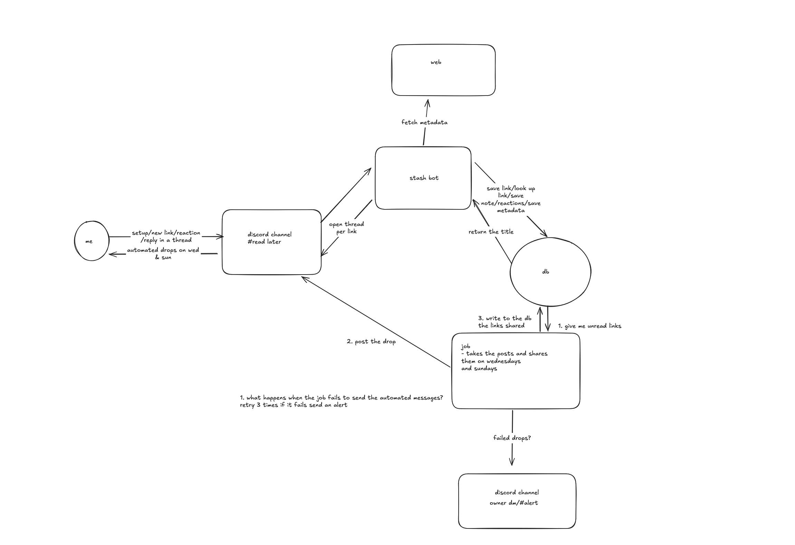

# system design

## notes not in the drawing

### host alerts

the bot is hosted once and added to many servers. when a drop fails after 3 retries, the server owner is alerted (dm, or their #alert channel if set). the host would not otherwise hear about it, so every failed drop is also sent to a host webhook.

- setup: in a discord channel, edit channel → integrations → webhooks → new webhook, copy the url, and set it as `ALERT_WEBHOOK_URL` in railway.
- if `ALERT_WEBHOOK_URL` is not set, host alerts are skipped.
- many servers failing in the same run usually means a global problem (db down, discord rejecting the bot).
- it can't report the bot being down, since the bot sends the alert. railway's deploy/crash notifications cover that.
- part of #16.

### ai tagging

not in the drawing: tagging was added after it. servers bring their own key (`/setkey`), so the host never pays for anyone's usage. supported providers: claude, openai, gemini, deepseek and openrouter. the base urls are fixed in code, so a server can't point the bot at an address of its choosing. keys are stored encrypted with `STASH_SECRET_KEY`. part of #4 and #11.

### metadata fetch failures

if fetching a page's metadata fails, the link is still saved and the site name is used as the title. part of #3.
